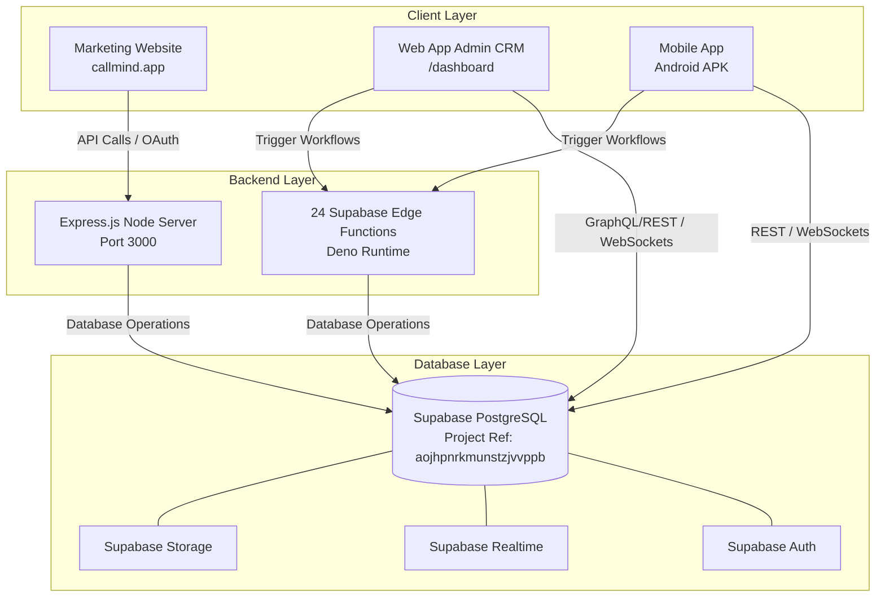

# CallMind Technical Architecture

This document acts as the master technical blueprint mapping out the system architecture, infrastructure, database schema, Row-Level Security, and AI pipelines used by the CallMind CRM ecosystem.

## ━━ 1. ARCHITECTURE OVERVIEW ━━



## ━━ 2. DETAILED TECH STACK ━━

### Web App + Website (Monorepo)
| Layer | Technology | Version | Notes |
| :--- | :--- | :--- | :--- |
| **Frontend** | React | 19 | Core UI library |
| **Language** | TypeScript | 5.8 | Strict typing across the repo |
| **Styling** | Tailwind CSS (v4) + Vanilla CSS | 4.1 | Glassmorphism utilities |
| **State Mgt.** | TanStack Query v5 + React Context | 5.100 | Server state caching & mutation |
| **Forms** | React Hook Form + Zod v4 | 7.74 / 4.4 | Schema-based validation |
| **Build Tool** | Vite 6 + esbuild | 6.2 | SSR prerendering enabled |
| **Backend API** | Express.js (Node 20) | 4.21 | Security: Helmet, CORS, CSRF |
| **AI Engine** | Google Gemini (@google/genai) | 1.29 | Integrated for lead summaries |

### Mobile App (Telecaller Tool)
| Layer | Technology | Notes |
| :--- | :--- | :--- |
| **Framework** | React Native + Expo | Android-first deployment (APK) |
| **Auth** | Supabase JS Client | MobileAuthProvider context |
| **Native APIs** | Expo Linking, Push | SIM telephony, Biometrics, GPS, Camera |

### Backend & Database (Supabase)
| Layer | Technology | Notes |
| :--- | :--- | :--- |
| **Database** | PostgreSQL | Shared schema between web and mobile |
| **Authentication**| Supabase Auth | Magic links, OAuth, JWT session management |
| **Realtime** | Supabase WebSockets | Live data sync for leads and team status |
| **Edge Functions**| Deno Serverless | Handles Lead Polling, WhatsApp, Email, GDPR Purge |

## ━━ 3. COMPREHENSIVE DATABASE SCHEMA ━━

*The database consists of 35+ tables. Below are the core tables essential to CRM operations.*

| Table | Primary Key | Tenant Column | Core Purpose & Notes |
| :--- | :--- | :--- | :--- |
| `companies` | `id` (uuid) | — | Master tenant record. Tracks subscription tier and limits. |
| `users` | `id` (uuid) | `company_id` | User profiles linked to Supabase Auth. Tracks role and onboarding. |
| `leads` | `id` (uuid) | `company_id` | CRM leads. Contains `deal_value` (numeric), `lost_reason` (text), and `custom_data` (JSONB). |
| `calls` | `id` (uuid) | `company_id` | Log of all SIM calls made via the mobile app. Includes duration, outcome, notes, and AI summary. |
| `invoices` | `id` (uuid) | `company_id` | Billing history and Razorpay payment records with PDF storage links. |
| `subscriptions`| `id` (uuid) | `company_id` | Detailed tracking of current plan, validity, and usage limits. |
| `audit_logs` | `id` (uuid) | `company_id` | Immutable system audit trail storing JSONB metadata of user actions. |
| `attendance_logs`| `id` (uuid) | `company_id` | Clock-in/Clock-out logs from the Mobile App. |

*Note: The legacy table `call_logs` exists but is deprecated; the application does NOT query this.*

## ━━ 4. ROW-LEVEL SECURITY (RLS) & ISOLATION ━━

CallMind is a true multi-tenant SaaS. Isolation is guaranteed at the Postgres level using RLS.

1. **Company ID Resolver:** 
   A Postgres function determines the tenant ID of the current authenticated user:
   ```sql
   CREATE FUNCTION public.get_my_company_id() RETURNS UUID AS $$
     SELECT company_id FROM public.users WHERE id = auth.uid();
   $$ LANGUAGE sql SECURITY DEFINER;
   ```

2. **Policy Enforcement:**
   Every tenant-specific table (e.g., `leads`) applies policies enforcing this check for all CRUD operations:
   ```sql
   CREATE POLICY "Users can only see their company leads"
   ON public.leads FOR SELECT
   USING (company_id = public.get_my_company_id());
   ```
   *This ensures zero cross-tenant data leakage, even if API endpoints are bypassed.*

## ━━ 5. AI GUARDRAIL PIPELINE ━━

CallMind heavily utilizes Google Gemini for call summarization and insights. To prevent abuse and prompt injection, all AI requests pass through a strict 6-step server-side pipeline:

1. **Input Reception:** Prompt received from the client.
2. **Length Check:** Rejects inputs > 2000 characters.
3. **HTML Sanitization:** Strips all HTML/XML tags.
4. **SQL Injection Detection:** Scans for common SQLi patterns.
5. **Jailbreak Regex Match:** Blocks prompts containing "ignore instructions", "DAN", "developer mode", etc.
6. **Gemini API Call:** Executes the sanitized prompt against the `@google/genai` SDK.
7. **Response Delivery:** Returns structured insights to the client.
