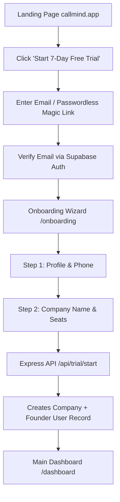

# CallMind Comprehensive User Flows

This document details the step-by-step user journeys for Founders, Telecallers, and Sub-Admins across the CallMind platform.

---

## ━━ 1. FOUNDER ONBOARDING & TRIAL FLOW ━━

1. **Visit Marketing Portal (`callmind.app`):** Prospect clicks "Start 7-Day Free Trial".
2. **Passwordless Magic Link:** Enter email address; Supabase dispatches instant magic link.
3. **Company Setup Wizard (`/onboarding`):**
   - **Personal Details:** Full name, mobile number.
   - **Company Profile:** Company name, industry, expected sales team size.
4. **Automated Trial Provisioning:**
   - Express server executes `/api/trial/start`.
   - Creates a new `companies` record with `plan_id = 'trial'` (4 seats, 1000 leads, 7 days).
   - Assigns the user role `founder` and links `company_id`.
5. **Dashboard Onboarding Checklist:** Founder lands on `/dashboard` with interactive setup steps (Invite Team, Connect IndiaMART, Import Leads).

---

## ━━ 2. TELECALLER MOBILE JOIN & CLOCK-IN FLOW ━━

1. **APK Installation:** Telecaller downloads the CallMind Android APK.
2. **Sign In & Join Code:**
   - Enters mobile number and authenticates via OTP.
   - Prompted: "Enter 6-digit Join Code provided by your Manager".
   - Submits Join Code → State set to `is_approved = FALSE`.
3. **Admin Approval Gate:**
   - Admin views "Pending Approvals" on Web CRM Team Page.
   - Approves agent, assigning them to a Pod/Team Lead → State updated to `is_approved = TRUE`.
4. **Daily Attendance Clock-In (GPS & Selfie):**
   - Telecaller opens app → Screen blocked by Attendance Gate.
   - App requests Camera & Location permissions.
   - Telecaller takes live selfie + captures GPS location.
   - Taps "Clock In" → Record saved in `agent_status`. App unlocks.

---

## ━━ 3. LEAD DIALING & DISPOSITION FLOW ━━

1. **Lead Queue Access:** Telecaller opens "My Leads" tab. Leads appear prioritized (Uncontacted first, then Scheduled Callbacks).
2. **One-Tap SIM Dialing:**
   - Telecaller taps the "Call" button on a lead card.
   - App prompts Dual-SIM selection (SIM 1 or SIM 2) if configured.
   - Launches Android native dialer (`tel:+91XXXXXXXXXX`).
3. **Active Call Overlay:** A floating overlay widget displays lead name and recent notes while calling.
4. **Post-Call Disposition Sheet:**
   - Phone call terminates → Telecaller returns to CallMind app.
   - App auto-opens the **Post-Call Feedback Sheet**.
   - **Outcome:** Selects `connected`, `busy`, `no_answer`, or `invalid`.
   - **Pipeline Status:** Updates to `Interested`, `Call Back`, `Won`, or `Lost`.
   - **Deal Value / Lost Reason:** Entered if converted (`Won`) or dropped (`Lost`).
   - **Voice Note:** Telecaller dictates notes via Speech-to-Text.
   - **Save & AI Summary:** Taps "Save". Backend sends notes to Gemini API for concise summary generation.

---

## ━━ 4. SUB-ADMIN DELEGATION & RE-ASSIGNMENT FLOW ━━

1. **Team Monitoring:** Sub-Admin views live sales floor status on Web CRM (`/team`).
2. **Re-assignment Trigger:** Sub-Admin notices an agent is offline or over-burdened with 100+ uncontacted leads.
3. **Bulk Lead Selection:**
   - Navigates to `/leads`. Filters by `assigned_to = Agent A` and `status = New`.
   - Selects all 100 leads.
4. **Re-assign Action:**
   - Clicks "Bulk Re-assign". Selects `Agent B`.
   - Backend updates `leads.assigned_to` and inserts 100 entries into `lead_activity`.
   - Agent B's mobile app receives immediate push notification and updates queue.
